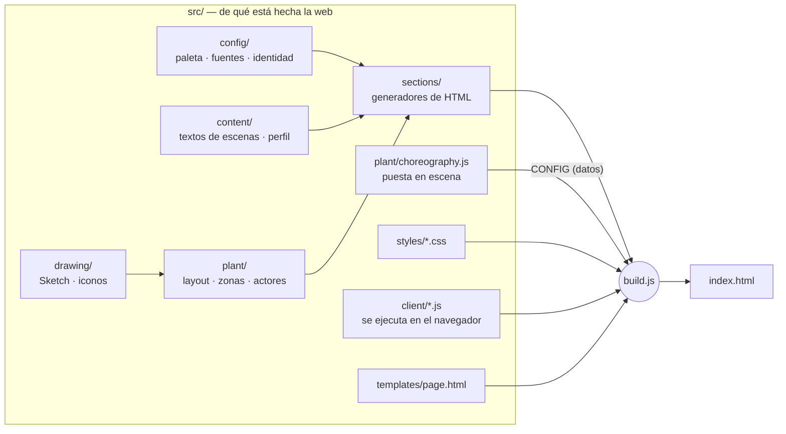

# andersein.com

[English](README.md) · **Español**

Web personal de **Ander Sein**, ingeniero de automatización e IIoT en Donostia-San Sebastián.

**→ [andersein.com](https://andersein.com)**

La página cuenta mi trabajo como una única historia con causa y efecto: un robot de inspección lee un manómetro, la lectura recorre la infraestructura de datos de la planta, se contrasta con el PLC, se confirma una alarma, el robot cierra una válvula manual y la bajada aparece en un dashboard. Cada paso es algo que he construido; cuando hay código público, la escena enlaza al repositorio que lo explica.

Este README trata de cómo está diseñada y construida la web, y por qué.

---

## 1. Diseño

### Primero la historia

Las primeras versiones eran un porfolio clásico: portada, tarjetas, lista de proyectos. Contaban *qué* había hecho, pero no *cómo encajan las piezas*, que es justo la parte de mi trabajo más difícil de enseñar. Por eso la web pasó a ser una sola historia en scroll donde cada escena es un proyecto y el orden de las escenas es el orden del dato:

| # | Escena | Qué pasa | Área de proyecto |
|---|---|---|---|
| 1 | Intro | La planta en reposo | — |
| 2 | Foto | El robot fotografía el manómetro local PI-104 | — |
| 3 | MQTT | La imagen llega al PC industrial | 01 · Captura de datos |
| 4 | Edge | Los contenedores del PC la recogen | 02 · Edge |
| 5 | Visión | El modelo localiza el manómetro (conf. 0,98) y lee 6,8 bar | 03 · Visión artificial |
| 6 | UNS | La lectura se publica en el Unified Namespace | 04 · Unified Namespace |
| 7 | PLC | El PLC publica su propio valor (PT-104, 6,7 bar) | 05 · Adquisición de PLC |
| 8 | Reglas | Los dos valores coinciden → alarma confirmada | 06 · Reglas y alarmas |
| 9 | Válvula | El robot cierra la válvula manual XV-104 | 07 · Robótica |
| 10 | Dashboard | La bajada de presión, leída del UNS | 08 · Plataforma de misiones |
| 11 | Cierre | Plano general de la planta | — |

Dos reglas mantienen la historia honesta: **nada ocurre sin una causa** (la válvula no tiene actuador, así que la tiene que cerrar el robot; la alarma necesita dos lecturas independientes) y **los textos presentan proyectos, no tecnologías** (los nombres de producto van en el README de cada repositorio, no en la página).

Tras la historia hay un índice de proyectos para quien prefiera saltar directamente.

### Lenguaje visual

- **Boceto de pizarra.** Todo está dibujado como en una pizarra: trazos a mano, una rejilla de puntos tenue, enlaces discontinuos. Se parece más a cómo un ingeniero explica una planta que un render 3D de catálogo, y envejece mejor.
- **"Dibujo a mano" reproducible.** Los trazos salen de [rough.js](https://roughjs.com) con una **semilla fija por dibujo**, así que cada build produce exactamente la misma imagen. Solo cambia algo cuando yo lo cambio, nunca por accidente.
- **Trazos que no escalan.** La planta es un único SVG alto sobre el que hace zoom la cámara. Las líneas usan `vector-effect: non-scaling-stroke`, de modo que mantienen el mismo grosor en pantalla con cualquier zoom.
- **Tres colores con significado.** Fondo azul marino, tinta clara, cian para el *dato* y ámbar solo para *alarmas*. Si algo es ámbar, algo va mal.
- **Tipografía servida en local.** Montserrat (títulos), Inter (texto), JetBrains Mono (valores y topics), todas con licencia SIL OFL 1.1.

## 2. Arquitectura

La web la genera un pequeño programa en Node. El resultado es **un único `index.html` autocontenido**: estilos, script y dibujo en línea; fuentes y favicon al lado. El visitante no carga ningún framework ni hace peticiones a terceros.



### Estructura de carpetas

```text
.
├── index.html              ← generado (lo sirve GitHub Pages; no se edita a mano)
├── fonts/                  ← woff2 locales + licencias
├── favicon.svg
├── src/
│   ├── build.js            ← monta index.html
│   ├── config/site.js      ← paleta, fuentes, título/descripción, enlaces de contacto
│   ├── content/
│   │   ├── scenes.js       ← las 11 escenas: título, texto, proyecto enlazado
│   │   └── profile.js      ← textos de perfil, trayectoria, contacto
│   ├── drawing/            ← kit de dibujo genérico, no sabe nada de la planta
│   │   ├── sketch.js       ← Sketch: envoltorio de rough.js con semilla (líneas, formas, texto, grupos)
│   │   ├── svg.js          ← posprocesado del markup (números compactos, grosores)
│   │   ├── icons.js        ← PC, PLC, cámara, manómetro, brazo robot… reutilizables
│   │   └── flourishes.js   ← monograma y subrayado
│   ├── plant/              ← el gran dibujo sobre el que se mueve la historia
│   │   ├── layout.js       ← tamaño del mundo y cada posición con nombre (anclas, rutas)
│   │   ├── zones/          ← un fichero por zona: proceso, edge, visión, uns, plc, reglas…
│   │   ├── actors.js       ← lo que se mueve: cuerpo del robot, brazo, volante de la válvula
│   │   ├── overlays.js     ← distintivos por escena (flash, foto, alarma, válvula)
│   │   ├── marks.js        ← círculo de rotulador y número alrededor de cada proyecto
│   │   ├── choreography.js ← cómo se escenifica cada escena (cámara, robot, etiqueta…)
│   │   └── index.js        ← drawPlant(): dibuja las zonas en orden
│   ├── sections/           ← funciones puras: datos de entrada, HTML de salida
│   ├── styles/             ← base, cabecera, secciones, historia, planta
│   ├── client/             ← código del navegador: geometría, cámara, historia
│   └── templates/page.html ← esqueleto de la página con {{marcadores}}
├── brand/                  ← mismo kit de dibujo, otros formatos
│   ├── card-front.js · card-back.js · social.js · cv-header.js
│   ├── repo-previews.js ← vistas previas de GitHub de los repos fijados (npm run previews)
│   ├── build.js            ← escribe los SVG en build/brand/
│   └── exports/            ← PNG finales (tarjeta, banner de LinkedIn, fondo 16:9, cabecera del CV)
├── tools/screenshots.js    ← cada escena en escritorio y móvil, para revisar
├── tools/og-image.js       ← og.png, la imagen que sale al compartir el enlace
└── services/cv-gate/       ← Worker de Cloudflare en cv.andersein.com (el CV, tras Turnstile)
```

### Cómo se relacionan las piezas

- **`drawing/` no sabe nada de la planta; `plant/` no sabe nada de la página.** Las piezas de marca (tarjeta, banners, cabecera del CV) reutilizan el kit tal cual, y así toda la identidad visual se mantiene coherente.
- **`layout.js` es la única fuente de posiciones.** Las zonas dibujan *alrededor* de puntos con nombre; la coreografía y el navegador usan los mismos nombres. Mover el hub del UNS es cambiar una coordenada.
- **Contenido y puesta en escena van separados a propósito.** `content/scenes.js` dice *qué* cuenta una escena; `plant/choreography.js` dice *a dónde* va la cámara y *qué se mueve*. Texto y escenificación cambian por motivos distintos, y separarlos evita que corregir una frase rompa una animación.
- **El navegador recibe datos, no lógica de la planta.** `build.js` combina escenas, coreografía y layout en un objeto `CONFIG` plano que se inyecta en la página. El código del cliente solo interpola entre los estados que recibe.

## 3. La historia en el navegador

La sección de la historia mide `N` pantallas de alto con un escenario fijo (*sticky*). El progreso del scroll `t` va de `0` a `N−1`: la parte entera es la escena actual y la decimal, cuánto se ha avanzado hacia la siguiente.

- **Pausa y luego movimiento.** El primer 32 % de cada transición se queda quieto para poder leer el texto; después cámara, robot y paquete se desplazan suavemente a la escena siguiente (`easeInOutCubic`).
- **Cámara = viewBox.** Mover la cámara es animar el `viewBox` del SVG entre los encuadres `[x, y, ancho]` de la coreografía. En móvil el encuadre se estrecha y se desplaza para que la planta quede bajo el texto.
- **Los saltos largos se alejan primero.** Una escena puede declarar `zoomOut`: la cámara se abre a mitad de camino para que un salto del fondo de la planta a la válvula se lea como "alejarse y volver a entrar" en lugar de un barrido borroso.
- **El paquete sigue una ruta real.** El paquete de datos recorre un trazado suavizado por la planta y la parada de cada escena se localiza sobre él por longitud. Un segundo paquete lleva el valor del PLC al UNS.
- **Los proyectos se rodean en la pizarra.** Al llegar a una escena con proyecto se dibuja un círculo de rotulador alrededor de la pieza que he hecho yo, con su número al lado, el mismo que aparece en el texto. En la última escena se encienden todos y la planta queda como mapa de proyectos.
- **Tamaño constante en pantalla.** La etiqueta del paquete y su estela se dimensionan en píxeles de pantalla, no en unidades del dibujo, para que se lean igual con cualquier zoom.
- **Navegación.** Los puntos de escena y el índice de proyectos saltan directamente a cualquier escena; con `prefers-reduced-motion` el salto es instantáneo y el robot no traquetea.

## 4. Por qué está hecha así

| Decisión | Motivo |
|---|---|
| Sin framework | Es una página con una interacción. Un framework añadiría peso y una cadena de build mayor que la propia web. |
| HTML generado, no escrito a mano | Solo el dibujo de la planta son miles de trazos SVG. Generarlo mantiene el código legible y el resultado reproducible. |
| Un único fichero autocontenido | Primer pintado rápido, funciona en cualquier hosting estático y no se rompe si cambia un CDN. |
| Fuentes locales, sin analítica | Sin peticiones a terceros, sin banner de cookies, nada que consentir. |
| Semillas fijas | El mismo código da siempre la misma imagen, así que un cambio en `index.html` es un cambio real. |
| Datos planos entre build y navegador | El código de la animación se entiende sin saber cómo se dibujó la planta. |
| Hosting estático (GitHub Pages) | Ningún servidor que mantener; el dominio apunta a Pages mediante DNS en Cloudflare. |

## 5. Generar la web

Requisitos: Node 18+. Las capturas necesitan además Chrome o Chromium local (`CHROME_PATH` para cambiar la ruta).

```bash
npm install
npm run build         # src/ → index.html
npm run brand         # piezas de marca → build/brand/*.svg
npm run screenshots   # cada escena, escritorio + móvil → build/screenshots/
npm run og            # imagen para compartir (última escena) → og.png
```

### Añadir una escena

1. Escribirla en `src/content/scenes.js` (título, texto, proyecto enlazado).
2. Escenificarla en `src/plant/choreography.js` (ancla, encuadre de cámara, posición del robot).
3. Si necesita un sitio nuevo en la planta: añadir el ancla en `layout.js` y dibujarlo en un fichero de `plant/zones/`.
4. `npm run build` y `npm run screenshots` para revisarla en escritorio y móvil.

---

## Contacto

- Correo: [aseinotegi@gmail.com](mailto:aseinotegi@gmail.com)
- LinkedIn: [Ander Sein](https://www.linkedin.com/in/ander-sein-a24097195/)
- GitHub: [aseinotegi](https://github.com/aseinotegi)

© Ander Sein. Código y diseño de uso personal; las fuentes conservan su propia licencia (ver `fonts/`).
