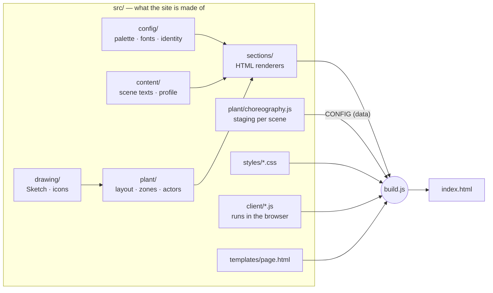

# andersein.com

**English** · [Español](README.es.md)

Personal website of **Ander Sein**, automation and IIoT engineer based in Donostia-San Sebastián.

**→ [andersein.com](https://andersein.com)**

The page tells my work as one causal story: an inspection robot reads a pressure gauge, the reading travels through the plant's data infrastructure, it is cross-checked against the PLC, an alarm is confirmed, the robot closes a manual valve and the drop shows up on a dashboard. Every step of that story is something I have built; where there is public code, the scene links to the repository that explains it.

This README is about how the site is designed and built, and why.

---

## 1. Design

### The story comes first

The first versions were a classic portfolio: a hero, cards, a list of projects. It said *what* I had done but not *how the pieces fit*, which is precisely the part of my job that is hard to show. So the site became a single scroll story where each scene is a project and the order of the scenes is the order of the data:

| # | Scene | What happens | Project area |
|---|---|---|---|
| 1 | Intro | The plant at rest | — |
| 2 | Photo | The robot photographs local gauge PI-104 | — |
| 3 | MQTT | The image reaches the industrial PC | 01 · Data capture |
| 4 | Edge | Containers on the PC pick it up | 02 · Edge |
| 5 | Vision | The model finds the gauge (conf. 0.98) and reads 6.8 bar | 03 · Computer vision |
| 6 | UNS | The reading is published to the Unified Namespace | 04 · Unified Namespace |
| 7 | PLC | The PLC publishes its own value (PT-104, 6.7 bar) | 05 · PLC data acquisition |
| 8 | Rules | Both values agree → alarm confirmed | 06 · Rules and alarms |
| 9 | Valve | The robot closes manual valve XV-104 | 07 · Robotics |
| 10 | Dashboard | The pressure drop, read from the UNS | 08 · Mission platform |
| 11 | Outro | Pull back to the whole plant | — |

Two rules kept the story honest: **nothing happens without a cause** (the valve has no actuator, so the robot has to close it; the alarm needs two independent readings), and **the texts present projects, not technologies** (product names live in each repository's README, not on the page).

There is also a project index after the story, for visitors who prefer to jump.

### Visual language

- **Whiteboard sketch.** Everything is drawn as if on a whiteboard: hand-made strokes, a faint dot grid, dashed links. It is closer to how an engineer explains a plant than a stock 3D render, and it ages better.
- **Reproducible "hand drawing".** The strokes come from [rough.js](https://roughjs.com) with a **fixed seed per drawing**, so every build produces exactly the same picture. A redraw happens only when I change something, never by accident.
- **Strokes that do not scale.** The plant is one tall SVG and the camera zooms over it. Lines use `vector-effect: non-scaling-stroke`, so they keep the same thickness on screen whatever the zoom.
- **Three colours with a meaning.** Navy background, light ink, cyan for *data* and amber only for *alarms*. If something is amber, something is wrong.
- **Self-hosted typography.** Montserrat (titles), Inter (text), JetBrains Mono (values and topics), all under SIL OFL 1.1.

## 2. Architecture

The site is generated by a small Node program. The output is a **single self-contained `index.html`**: styles, script and drawing inline; fonts and favicon next to it. The visitor loads no framework and makes no request to third parties.



### Folder structure

```text
.
├── index.html              ← generated (served by GitHub Pages; do not edit by hand)
├── fonts/                  ← self-hosted woff2 + licences
├── favicon.svg
├── src/
│   ├── build.js            ← assembles index.html
│   ├── config/site.js      ← palette, fonts, title/description, contact links
│   ├── content/
│   │   ├── scenes.js       ← the 11 scenes: title, text, linked project
│   │   └── profile.js      ← about, career, contact texts
│   ├── drawing/            ← generic drawing toolkit, knows nothing about the plant
│   │   ├── sketch.js       ← Sketch: seeded rough.js wrapper (lines, shapes, text, groups)
│   │   ├── svg.js          ← markup post-processing (number compaction, stroke widths)
│   │   ├── icons.js        ← PC, PLC, camera, gauge, robot arm… reusable everywhere
│   │   └── flourishes.js   ← monogram and squiggle
│   ├── plant/              ← the big drawing the story moves over
│   │   ├── layout.js       ← world size and every named position (anchors, routes)
│   │   ├── zones/          ← one file per area: process, edge, vision, uns, plc, rules…
│   │   ├── actors.js       ← parts that move: robot body, arm, valve handwheel
│   │   ├── overlays.js     ← badges shown per scene (flash, photo, alarm, valve)
│   │   ├── marks.js        ← marker loop and number around each project
│   │   ├── choreography.js ← how each scene is staged (camera, robot, label…)
│   │   └── index.js        ← drawPlant(): draws the zones in order
│   ├── sections/           ← pure functions: data in, HTML string out
│   ├── styles/             ← base, header, sections, story, plant
│   ├── client/             ← browser code: geometry, camera, story
│   └── templates/page.html ← page skeleton with {{placeholders}}
├── brand/                  ← same drawing toolkit, other formats
│   ├── card-front.js · card-back.js · social.js · cv-header.js
│   ├── repo-previews.js ← GitHub social previews of the pinned repos (npm run previews)
│   ├── build.js            ← writes the SVGs to build/brand/
│   └── exports/            ← final PNGs (card, LinkedIn banner, 16:9 background, CV header)
├── tools/screenshots.js    ← every scene on desktop and phone, for review
└── tools/og-image.js       ← og.png, the image shown when the link is shared
```

### How the pieces relate

- **`drawing/` knows nothing about the plant; `plant/` knows nothing about the page.** The toolkit is reused as-is by the brand pieces (business card, banners, CV header), which is how the whole visual identity stays consistent.
- **`layout.js` is the single source of positions.** Zones draw *around* named points; the choreography and the browser refer to the same names. Moving the UNS hub means changing one coordinate.
- **Content and staging are separate files on purpose.** `content/scenes.js` says *what* a scene says; `plant/choreography.js` says *where* the camera goes and *what moves*. Wording and staging change for different reasons, and keeping them apart means a text edit cannot break an animation.
- **The browser receives data, not logic about the plant.** `build.js` merges scenes, choreography and layout into a plain `CONFIG` object injected into the page. The client code only interpolates between the states it is given.

## 3. The story in the browser

The story section is `N` screens tall with a sticky stage. Scroll progress `t` goes from `0` to `N−1`: the integer part is the current scene, the fraction is how far we are into the transition to the next one.

- **Hold, then move.** The first 32 % of each transition stands still so the caption can be read, then camera, robot and packet ease into the next scene (`easeInOutCubic`).
- **Camera = viewBox.** Moving the camera is animating the SVG `viewBox` between the `[x, y, width]` frames in the choreography. On phones the frame is narrowed and shifted so the plant sits below the caption.
- **Long jumps pull back first.** A scene can declare `zoomOut`: the camera widens mid-flight so a jump from the bottom of the plant to the valve reads as "zoom out, then go there" instead of a blur.
- **The packet follows a real route.** The data packet travels along a smoothed path through the plant; each scene's stop is located on it by length. A second packet carries the PLC value into the UNS.
- **Projects are circled on the board.** When a scene with a project arrives, a marker loop is drawn around the piece I built and its number appears next to it, the same number as in the caption. In the last scene all the loops are on, so the plant becomes the project map.
- **Constant on-screen size.** The packet label and its trail are sized in screen pixels, not world units, so they stay readable at every zoom.
- **Navigation.** Scene dots and the project index jump straight to any scene; with `prefers-reduced-motion` those jumps are instant and the robot does not bounce.

## 4. Why it is built this way

| Decision | Reason |
|---|---|
| No framework | It is one page with one interaction. A framework would add weight and a build chain bigger than the site itself. |
| Generated, not handwritten HTML | The plant drawing alone is thousands of SVG paths. Generating it keeps the source readable and the output reproducible. |
| One self-contained file | Fast first paint, works on any static host, nothing to break when a CDN changes. |
| Self-hosted fonts, no analytics | No third-party requests, no cookie banner, nothing to consent to. |
| Fixed seeds | The same source always gives the same picture, so a diff in `index.html` means a real change. |
| Plain data between build and browser | The animation code can be read without knowing how the plant was drawn. |
| Static hosting (GitHub Pages) | No server to maintain; the domain points to Pages through Cloudflare DNS. |

## 5. Building

Requirements: Node 18+. Screenshots also need a local Chrome or Chromium (`CHROME_PATH` to override the path).

```bash
npm install
npm run build         # src/ → index.html
npm run brand         # brand pieces → build/brand/*.svg
npm run screenshots   # every scene, desktop + phone → build/screenshots/
npm run og            # share image (last scene) → og.png
```

### Adding a scene

1. Write it in `src/content/scenes.js` (title, text, linked project).
2. Stage it in `src/plant/choreography.js` (anchor, camera frame, robot position).
3. If it needs a new place in the plant: add the anchor to `layout.js` and draw it in a file under `plant/zones/`.
4. `npm run build` and `npm run screenshots` to check it on desktop and phone.

---

## Contact

- Email: [aseinotegi@gmail.com](mailto:aseinotegi@gmail.com)
- LinkedIn: [Ander Sein](https://www.linkedin.com/in/ander-sein-a24097195/)
- GitHub: [aseinotegi](https://github.com/aseinotegi)

© Ander Sein. Code and design for personal use; fonts keep their own licence (see `fonts/`).
